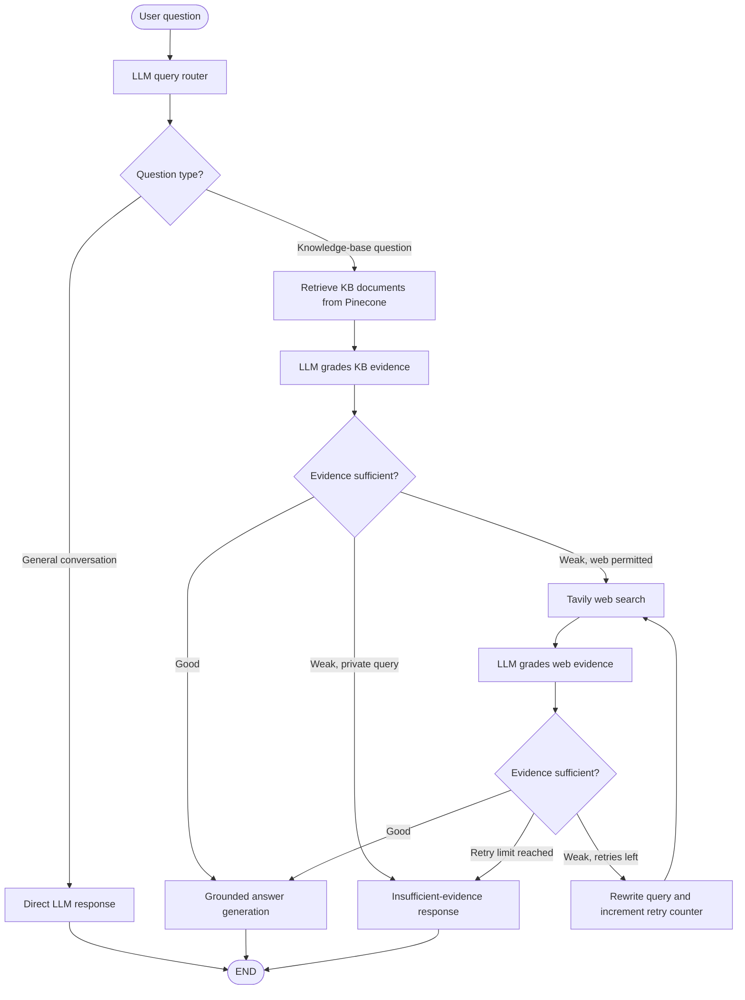

# Enterprise-Agentic-RAG-Project
Enterprise RAG chatbot that can help teams

# Enterprise Agentic RAG

**An adaptive Retrieval-Augmented Generation (RAG) application built with LangGraph, LangChain, Pinecone, Tavily, Groq, and Langfuse.**

The application routes incoming questions to either a knowledge-base retrieval workflow or a direct LLM response. For knowledge-base questions, it retrieves documents, evaluates whether the evidence is sufficient, and generates a grounded answer. When local evidence is insufficient and public web search is appropriate, it can search the web, evaluate the new evidence, rewrite queries, and retry within a defined limit.

> **Project status:** Actively developed. This README describes the workflow under development; individual integrations and entry points may vary across branches. Do not use public web search for confidential enterprise information.

## Highlights

- **Adaptive routing** — send general questions directly to the LLM, and knowledge-dependent questions to retrieval.
- **Knowledge-base retrieval** — semantic search over embedded document chunks stored in **Pinecone**.
- **Evidence grading** — use structured LLM outputs (`good` / `weak`) to decide whether retrieved content is sufficient.
- **Web fallback** — use **Tavily** for public information when the local knowledge base cannot answer a question.
- **Self-correction** — rewrite search queries and retry with a bounded retry count.
- **Grounded generation** — generate answers using retrieved context and acknowledge insufficient evidence.
- **Observability** — inspect LangGraph execution, LLM calls, retrieval latency, and tool activity using **Langfuse**.

## Architecture



**Observability:** Langfuse can capture the overall execution and supported LangChain/LangGraph steps via its callback integration. Custom spans may be added to track additional operations.

## Technology stack

| Layer | Technology | Purpose |
| --- | --- | --- |
| Language | Python | Application and orchestration |
| Orchestration | LangGraph | Stateful graph with conditional routing |
| LLM integration | LangChain | Model, retriever, and tool abstractions |
| LLM inference | Groq (`ChatGroq`) | Routing, grading, rewriting, and answer generation |
| Vector database | Pinecone | Semantic vector retrieval |
| Embeddings | HuggingFace / sentence-transformers | Local query and document embeddings |
| Web search | Tavily | Public-web fallback |
| Structured responses | Pydantic | Validated route and evidence-grade results |
| Observability | Langfuse | Traces, LLM usage, latency, and evaluations |
| Environment / dependencies | uv | Virtual environments and reproducible installs |

**Optional integrations:** FastAPI, document ingestion using `pypdf` / `python-docx`, evaluation with RAGAS or DeepEval, and Redis caching can be added as the project evolves. Their availability depends on the code in this repository.

## Workflow

1. **Route question:** The LLM returns a structured route such as `kb` or `direct`.
2. **Retrieve:** For `kb`, the retriever fetches relevant `Document` objects from Pinecone.
3. **Grade local evidence:** A structured LLM grader returns `good` or `weak`.
4. **Answer or search:** `good` leads to grounded generation. `weak` may lead to Tavily if public-web lookup is permitted.
5. **Grade web evidence:** Determine if web results are relevant and sufficient.
6. **Rewrite / retry:** When results are insufficient, improve the query and retry up to a configured limit.
7. **Fallback:** If no adequate evidence is available, return an explicit insufficient-evidence response instead of inventing facts.
8. **Trace:** Send supported execution information to Langfuse for inspection.

## Getting started

### Prerequisites

- Python **3.11** (recommended starting point; verify compatibility with your installed dependencies)
- [uv](https://docs.astral.sh/uv/)
- A **Pinecone** account and index
- A **Groq** API key
- A **Tavily** API key for web-search fallback
- A **Langfuse** project and API keys for observability (optional)

### 1. Clone

```bash
git clone https://github.com/ganesh3-reddy/Enterprise-Agentic-RAG-Project.git
cd Enterprise-Agentic-RAG-Project
```

### 2. Install dependencies

**If the repository contains `pyproject.toml` and `uv.lock` (preferred):**

```bash
uv sync --locked
```

**If the repository uses `requirements.txt` instead:**

```bash
uv venv --python 3.11
uv pip install -r requirements.txt
```

Use one dependency-management workflow consistently. On Windows, you can run scripts via `uv run python ...` without manually activating `.venv` when using a uv-managed project.

### 3. Configure environment variables

Create a `.env` file in the project root (do **not** commit it):

```dotenv
# Required for the corresponding integrations
GROQ_API_KEY=your_groq_api_key
PINECONE_API_KEY=your_pinecone_api_key
PINECONE_INDEX_NAME=your_index_name
TAVILY_API_KEY=your_tavily_api_key

# Optional: Langfuse observability
LANGFUSE_PUBLIC_KEY=your_langfuse_public_key
LANGFUSE_SECRET_KEY=your_langfuse_secret_key
LANGFUSE_BASE_URL=https://cloud.langfuse.com
```

Set `LANGFUSE_BASE_URL` to your actual project region, if different. Ensure your Python code loads the environment *before* initializing clients:

```python
from dotenv import load_dotenv
load_dotenv()
```

### 4. Run the application

Find the entry point used by your branch (a Python script, notebook, or FastAPI application). For example, **if** the repository provides `main.py`:

```bash
uv run python main.py
```

For an interactive notebook, select the project's `.venv` interpreter in VS Code and execute the cells in order. The repository's real filename and entry point take precedence over this example.

## Example LangGraph invocation with Langfuse

The following assumes a compiled LangGraph object named `graph` and a configured `.env` file:

```python
from dotenv import load_dotenv
from langfuse import get_client
from langfuse.langchain import CallbackHandler

load_dotenv()

langfuse = get_client()
handler = CallbackHandler()

initial_state = {
    "question": "What happens if retrieved documents are irrelevant in Agentic RAG?",
    "retry_count": 0,
}

result = graph.invoke(
    initial_state,
    config={"callbacks": [handler], "run_name": "enterprise-agentic-rag"},
)

langfuse.flush()  # Useful in notebooks and short-lived scripts
print(result.get("answer"))
```

In a long-running production service, prefer background export and flush during a controlled shutdown rather than after each request. Open **Langfuse → Tracing** to inspect captured operations. Be mindful that captured prompts and outputs can contain sensitive document text.

## Observability and performance

This project uses Langfuse to inspect questions such as:

- Did the router select the knowledge base or a direct answer?
- Which documents did Pinecone return?
- Why did the KB grader choose `weak`?
- Did the request unnecessarily fall back to the web?
- How much time did embedding, retrieval, web search, grading, and generation take?
- How often did query rewriting occur?

**Local development observations (illustrative, not guaranteed benchmarks):** warm Pinecone queries have been observed around **0.4–0.6 seconds**, while some first/idle requests took **1–2+ seconds**. Network conditions, SDK settings, infrastructure region, and request patterns can all influence latency. Collect representative P50/P95 measurements before making performance claims.

### Recommended evaluations

| Evaluation | What to measure |
| --- | --- |
| Retrieval relevance | How relevant the returned chunks are to a query |
| Context recall | Whether retrieved evidence contains the needed facts |
| Faithfulness | Whether generated claims are supported by evidence |
| Answer correctness | Agreement with a trusted reference answer |
| Router accuracy | Whether the graph selected the appropriate route |
| Fallback rate | How often KB queries proceed to Tavily |
| End-to-end latency | Request P50 / P95 / P99 |
| Cost | LLM tokens, model costs, and tool usage |

## Security and reliability considerations

- Keep API keys in environment variables or a secrets manager, never in the repository.
- Avoid logging personally identifiable information or confidential documents without appropriate redaction and authorization.
- **Do not send private enterprise data to public search APIs**; make web fallback conditional on data classification.
- Treat retrieved documents and web pages as untrusted input; resist prompt injection and do not execute instructions found in search results.
- Validate structured LLM output using Pydantic schemas.
- Bound query-rewrite retries to prevent infinite loops and unexpected API costs.
- Add timeouts, retry/backoff behavior, and explicit errors around external services.
- Scope retrieval and cached responses to authorized users/tenants when applicable.
- Avoid inventing citations or unsupported answers when evidence is insufficient.

## Suggested future improvements

- [ ] Add FastAPI endpoints and request validation
- [ ] Add document ingestion, chunking, and incremental indexing
- [ ] Add relevance thresholds and optional reranking
- [ ] Add a dataset-driven Langfuse evaluation pipeline
- [ ] Compare RAGAS/DeepEval quality metrics across retrieval settings
- [ ] Add per-request timeouts and bounded retries for each external tool
- [ ] Add Redis caching and rate limiting if traffic warrants it
- [ ] Add authorization and tenant-aware KB filters
- [ ] Add automated testing and CI checks
- [ ] Containerize and deploy the application

## Repository notes

- `uv.lock` should be committed alongside `pyproject.toml` when using uv project management.
- `.venv/`, `.env`, API keys, proprietary documents, and generated caches should not be committed.
- A public repository should include only data you have permission to share.

## License

A license has not been specified here. If you want the project to be open source, choose and add a `LICENSE` file (for example, MIT or Apache-2.0) after checking ownership and third-party licensing constraints.

---

**Built to explore practical, observable, and reliable Agentic RAG workflows.**
